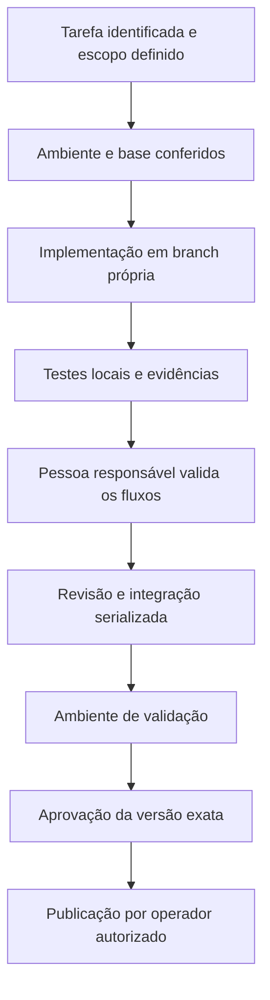

# Operations Brain — infraestrutura de coordenação

Uma equipe de agentes precisa de mais do que memória e prompts: precisa saber quem está trabalhando, em qual tarefa, sobre qual versão e com quais permissões. Operations Brain é o modelo público e genérico dessa camada.

O desenho incorpora padrões utilizados e aprovados na prática de uma operação de desenvolvimento. Aqui é compartilhada somente a ideia de infraestrutura, com exemplos fictícios. Este documento não exporta o sistema de origem, seus comandos, configurações, contas, projetos, permissões ou dados. Também não fornece um serviço executável de governança.

## Três fontes com responsabilidades diferentes

| Camada | Responsabilidade |
| --- | --- |
| Git | Código, branches, commits e revisão de alterações |
| Orchestra Brain | Conhecimento durável, decisões e referências relevantes |
| Operations Brain | Estado de tarefas, identidade operacional, permissões e evidências de transição |

Uma quarta camada, o runtime, executa ferramentas e guarda resultados temporários. Painéis e canais de chat exibem o estado, mas não concedem autoridade por si mesmos.

## Identidade e escopo

Uma identidade operacional combina pessoa ou agente, sessão e dispositivo. O acesso a uma conta de IA não deve ser usado para inferir permissão de integração ou publicação.

Cada tarefa tem objetivo, escopo de arquivos ou domínio, responsável principal, branch de trabalho e critério de conclusão. Antes de editar, compare a base local com a base vigente. Preserve alterações existentes e registre sobreposições para coordenar o trabalho.

## Verificações antes de avançar

Uma implementação pode disponibilizar verificações de identidade, saúde do ambiente, presença da equipe, atualização da base e prontidão da tarefa. Os nomes dos comandos dependem de quem implementar o modelo; não há um CLI universal incluído neste repositório.

As políticas de cada projeto definem quais etapas se aplicam. Não marque validação humana como concluída somente porque um teste automatizado passou ou uma página abriu. Uma alteração posterior deve revalidar as evidências afetadas.

## Locks e aprovações

Use locks para serializar operações que não podem ocorrer simultaneamente, como integrar uma branch compartilhada ou publicar uma versão. Um lock precisa identificar proprietário, finalidade, validade e recuperação após falha.

Associe uma aprovação à versão exata do artefato ou manifesto. Se o conteúdo mudar, a aprovação anterior não deve liberar automaticamente o novo conteúdo. Separe permissão para desenvolver, validar e publicar.

As verificações devem existir no ponto real de execução, com controles de acesso adequados. Um arquivo de instruções descrevendo uma regra não equivale a um bloqueio técnico. O armazenamento de locks e concessões precisa oferecer consistência suficiente; sincronizar um arquivo pelo Drive não implementa essa garantia.

## Continuidade entre dispositivos

Uma transferência de trabalho registra objetivo, responsável, último passo, próximo passo, versão do código, alterações pendentes, artefatos necessários e resultados de testes. O destino confirma o recebimento e a capacidade de continuar antes de assumir a execução.

Mantenha um executor ativo por tarefa. Uma transferência incerta exige reconciliação; não inicie uma segunda execução supondo que a primeira parou. O cérebro sincronizado ajuda a recuperar contexto, enquanto o registro operacional controla a posse da tarefa.

## Estado e auditoria

Registre eventos pequenos: criação da tarefa, início, checkpoint, revisão, aprovação, integração e conclusão. Diferencie agente conectado, tarefa ativa e entrega concluída.

Use índices de presença e consultas delimitadas em vez de varrer todo o histórico para responder quem está trabalhando. Registre evidência e referência de artefato; não copie conversas completas, dados de clientes, credenciais ou logs brutos.

## Como começar a implementar

1. Defina identidades e permissões próprias, sem permissões padrão de publicação.
2. Crie um contrato de tarefa e uma máquina de estados explícita.
3. Escolha um registro operacional com escrita consistente, separado do acervo de notas.
4. Implemente verificações e locks no caminho de execução; teste concorrência e falhas.
5. Vincule testes e aprovações à versão real da entrega.
6. Integre esse registro ao Maestro e aos especialistas; o chat deve refletir o estado confirmado.

O resultado esperado é uma equipe que compartilha conhecimento, mantém autoria e respeita limites operacionais sem depender de uma conversa longa para reconstruir tudo.
