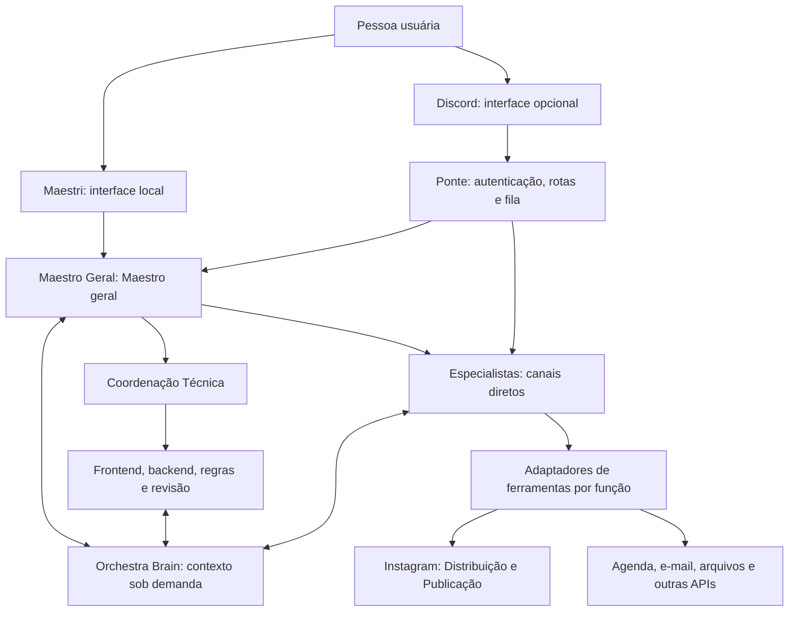

# Brain Orchestra

Uma estrutura reutilizável para organizar agentes de IA como uma orquestra: um Maestro coordena, especialistas executam e um cérebro de contexto preserva o conhecimento útil.

**Estado:** arquitetura de referência, gerador local de estrutura e guia de montagem. O gerador cria arquivos de memória e papéis; não inicia terminais automaticamente. Este repositório não contém um bot Discord ou um publicador Instagram. Essas integrações precisam ser implementadas e validadas por quem adotar a estrutura.

Projeto independente, sem afiliação oficial ao Maestri, à Meta ou aos provedores de modelos.

## A ideia

Cada agente tem uma responsabilidade clara, ferramentas limitadas à sua função e uma entrega verificável. O Maestro distribui trabalho, acompanha dependências e consolida resultados. Um especialista não desaparece atrás do coordenador: a entrega preserva sua autoria.

O Maestri fornece o ambiente visual para terminais, agentes e conexões. A orquestra é o método de organização proposto aqui; o Orchestra Brain é a camada de memória. APIs conectam cada função às ferramentas necessárias.



As caixas de integração representam componentes a construir/configurar, não serviços distribuídos neste repositório.

## Cada agente faz o seu

Os agentes são identificados pela função que exercem. Use apenas os papéis de que precisar; não é necessário manter todos ativos.

| Agente | Responsabilidade | Entrega e ferramentas possíveis |
| --- | --- | --- |
| Maestro Geral | Maestro geral | Triagem, delegação, acompanhamento e consolidação |
| Secretaria | Secretaria | Agenda, organização e rascunhos; conectores de calendário/e-mail |
| Coordenação Operacional | Operações | Planos, dependências, prazos e impedimentos |
| Estratégia de Conteúdo | Estratégia de conteúdo | Posicionamento, pautas e briefings |
| Estratégia de Negócios | Planejamento de negócio | Diagnósticos e alternativas com premissas |
| Edição de Vídeo Educativo | Vídeo educativo | Roteiro técnico, edição e revisão audiovisual |
| Criação de Criativos | Criativos curtos | Peças e variações de campanha |
| Produção de Carrosséis | Carrosséis | Estrutura editorial e peças em sequência |
| Distribuição e Publicação | Distribuição | Preparação e publicação autorizada; adaptador Instagram/Meta |
| Desenvolvimento Web e Integrações | Sites e integrações | Interfaces, sites, e-commerce e conectores |
| Relacionamento com Clientes | Relacionamento | Histórico de atendimento e próximos passos por contexto |
| Apoio aos Estudos | Estudos | Explicações, exercícios e materiais de aprendizagem |
| Organização Financeira | Organização financeira | Orçamentos e simulações com dados fornecidos; sem acesso automático a contas |
| Coordenação Técnica | Maestro técnico | Divisão do trabalho de desenvolvimento e consolidação técnica |
| Desenvolvimento Frontend | Frontend | Interface e acessibilidade |
| Regras de Negócio | Regras de negócio | Regras e validações de domínio |
| Desenvolvimento Backend | Backend | APIs e integrações de dados |
| Revisão e Qualidade | Revisão e qualidade | Análise independente e evidências de verificação |

Os conectores da tabela são possibilidades de configuração. Nomear um agente não concede acesso a contas nem cria uma integração.

## Orchestra Brain: o cérebro armazenador de contexto

Em vez de inserir toda a memória em toda mensagem, mantenha conhecimento em arquivos pequenos e consultáveis:

1. Leia um índice curto (`RECALL.md`).
2. Escolha somente as notas relevantes para a tarefa.
3. Abra os trechos necessários e passe ao especialista apenas o contexto de que ele precisa.
4. Após a entrega, atualize a nota canônica com fatos úteis, fontes e decisões.
5. Em uma nova sessão, recupere o que importa sem repetir a conversa inteira.

Isso pode reduzir contexto repetido e uso desnecessário de tokens. Não elimina o custo das instruções, das ferramentas, da recuperação ou dos vários agentes; não há economia percentual garantida. Compare tarefas equivalentes e meça tokens de entrada, saída, chamadas e qualidade do resultado.

O cérebro não é o processo de um agente nem uma fila de trabalho. Ele armazena conhecimento durável; o runtime armazena pedidos, estados, locks e resultados temporários.

## Um fluxo de exemplo

1. Uma solicitação fictícia chega ao canal do Maestro: preparar um carrossel sobre um tema público.
2. Maestro Geral define objetivo, limites e critério de conclusão; Estratégia de Conteúdo prepara o briefing.
3. Produção de Carrosséis produz a peça; um revisor verifica conteúdo e formato.
4. Distribuição e Publicação apresenta mídia, legenda, versão e destino para aprovação.
5. Com uma integração implementada e aprovação válida, Distribuição e Publicação publica e devolve o identificador da publicação. Sem integração, entrega um pacote pronto para publicação manual.
6. O Orchestra Brain recebe apenas aprendizados reutilizáveis e referências; o histórico completo fica fora do prompt padrão.

## Como começar

Abra este repositório em uma sessão local do Claude Code ou Codex e peça:

> Leia AGENTS.md e monte a estrutura completa do Brain Orchestra em uma pasta privada nova, fora deste repositório. Use apenas os modelos genéricos. Verifique o que foi criado e diferencie arquivos gerados de agentes e integrações realmente ativos.

O agente encontra o procedimento em `AGENTS.md` (ou pela entrada `CLAUDE.md`), executa `bootstrap.py` e verifica o resultado. Isso depende de acesso local de escrita e Python 3.10 ou superior. Uma conversa web com acesso somente de leitura ao GitHub não consegue criar arquivos no seu computador.

Para gerar manualmente todos os papéis:

```sh
python bootstrap.py --target ../orchestra-workspace --full --dry-run
python bootstrap.py --target ../orchestra-workspace --full
```

O destino deve ficar fora do checkout público. Sem `--full`, o gerador prepara apenas o núcleo de três papéis. Ele não sobrescreve arquivos modificados e permite verificar novamente uma instalação idêntica. Python não é necessário depois para ler os modelos.

Leia [INSTALACAO.md](INSTALACAO.md) para montar o núcleo no Maestri, [BRAIN.md](BRAIN.md) para criar memória própria e [INTEGRACOES.md](INTEGRACOES.md) para projetar Discord e APIs por função. [MODELOS.md](MODELOS.md) contém instruções e contratos genéricos para copiar.

Comece com três agentes: Maestro, executor e revisor. Amplie quando existir uma entrega recorrente que justifique outra função.

## Escopo e contribuição

Este pacote compartilha o método e exemplos novos e genéricos. Cada pessoa cria sua própria memória privada e configura suas próprias contas. Não é uma exportação de um ambiente operacional existente.

Contribuições úteis: melhorar instruções de montagem, implementar adaptadores independentes, criar testes de contratos e medir recuperação de contexto. Use dados sintéticos em exemplos e mantenha credenciais fora do Git.

## Referências

- [Maestri: introdução](https://www.themaestri.app/en/docs/intro)
- [Workspaces e arquivos de instruções](https://www.themaestri.app/en/docs/workspaces)
- [Terminais e agentes](https://www.themaestri.app/en/docs/terminals)
- [Maestro Mode](https://www.themaestri.app/en/docs/maestro)
- [Maestri Wire](https://www.themaestri.app/en/docs/wire)
- [Discord Gateway](https://docs.discord.com/developers/events/gateway)
- [Meta: publicação no Instagram](https://developers.facebook.com/docs/instagram-platform/content-publishing/)

## Licença

Os materiais originais deste repositório estão sob a [licença MIT](LICENSE). Produtos, modelos e serviços externos têm suas próprias licenças e condições.
