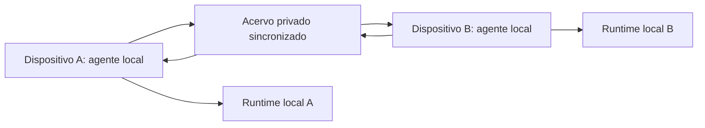

# Da memória externa ao Orchestra Brain

## Origem e crédito

A base conceitual vem do [Cérebro Claude, de Josh / joshazze](https://github.com/joshazze/cerebro-claude), especialmente do seu [documento de teoria](https://github.com/joshazze/cerebro-claude/blob/main/docs/teoria.md). A contribuição original é organizar memória durável em notas ligadas, apresentar um mapa compacto ao agente e recuperar conteúdo conforme a tarefa. Índices, relações e outras tarefas mecânicas podem ser mantidos por scripts, sem uma chamada ao modelo para cada operação.

O contexto funciona como uma área de trabalho limitada: guardar mais conhecimento em disco não exige colocá-lo inteiro no prompt. A separação entre acervo e contexto ativo é o ponto de partida desta adaptação. O Brain Orchestra credita essa base e acrescenta organização entre dispositivos, agentes e funções. Não apresenta a ideia de memória externa como uma invenção própria.

## Por que isso pode reduzir o gasto de tokens

Considere um exemplo inteiramente fictício: um acervo tem 80 mil tokens, mas uma tarefa precisa de um índice de 800 e de duas notas que somam 2 mil. A política seletiva acrescentaria cerca de 2.800 tokens de memória àquela consulta, em vez dos 80 mil do acervo integral.

Esses valores ilustram a diferença entre carregar o acervo e recuperar um conjunto relevante; não são medições deste projeto. Instruções, conversa, ferramentas, saídas, chamadas adicionais e regras de cache também participam do custo. Uma busca mal direcionada pode causar mais leituras e retrabalho.

A aplicação prática é começar pelo índice, seguir referências e reaproveitar o contexto que já foi lido. Quando faltarem dados, ampliar a consulta de forma justificada. Uma restrição fixa de poucas leituras não deve impedir a recuperação necessária a uma resposta correta.

## O que esta adaptação acrescenta

| Camada | Evolução no Brain Orchestra |
| --- | --- |
| Portabilidade | O conhecimento permanece em arquivos legíveis; a ferramenta de IA pode mudar sem recriar o acervo |
| Vários dispositivos | Uma pasta privada no Google Drive transporta o conhecimento consolidado entre instalações |
| Vários agentes | Especialistas consultam a mesma referência canônica, recebendo apenas o contexto pertinente à função |
| Separação de responsabilidades | Memória, execução e governança têm papéis diferentes |
| Instalação assistida | Instruções e um gerador permitem preparar uma estrutura nova a partir de Claude Code ou Codex |
| Privacidade | O repositório contém modelos e exemplos fictícios; cada adotante mantém seu próprio acervo privado |

Essa evolução foi aplicada em uso real ao mesmo acervo com Codex, Antigravity e Claude Code. Esse relato de funcionamento descreve a experiência que motivou a adaptação; não significa uma certificação de todas as versões, ambientes ou ferramentas, nem uma medição comparativa de economia de tokens.

## Google Drive como camada de continuidade do conhecimento

O [Drive para computador](https://support.google.com/drive/answer/10838124?hl=pt-BR) disponibiliza arquivos no sistema local e sincroniza suas alterações. A proposta é manter o cérebro privado sincronizado e configurar cada agente para consultar essa pasta em seu dispositivo.

Uma decisão consolidada em um dispositivo pode ser recuperada pelo outro depois da sincronização. Isso preserva conhecimento entre sessões; não transfere o processo, a sessão autenticada ou a memória RAM do agente.

### Como montar sem publicar memória privada

1. Gere uma estrutura privada nova seguindo [INSTALACAO.md](INSTALACAO.md).
2. Escolha uma pasta privada dedicada no Google Drive para o cérebro. Na primeira instalação, copie apenas a árvore `brain/` gerada, mantendo seus caminhos relativos. Não publique essa pasta nem a compartilhe por link público.
3. Em cada dispositivo, descubra o caminho local dessa mesma pasta. Não suponha letras de unidade, diretórios ou nomes de conta iguais.
4. Ajuste as instruções privadas do agente para definir essa pasta como raiz da memória. Atualize também as referências locais a `brain/RECALL.md` e às demais notas nos arquivos de instruções e papéis. O gerador atual usa `brain/` local por padrão; não configura o Google Drive automaticamente.
5. Conceda acesso apenas à pasta necessária, usando os controles suportados pela ferramenta. Não copie credenciais de um dispositivo para outro.
6. Grave uma nota fictícia em um dispositivo, aguarde a sincronização e confira o conteúdo no outro. Só depois teste a recuperação pelo agente de destino.
7. Mantenha runtimes, filas, locks, bancos de execução e checkouts de código locais ou em um serviço de coordenação apropriado. A sincronização de notas não é um mecanismo de exclusão mútua.

Use um responsável por nota durante a edição, espere a sincronização antes de trocar de dispositivo e resolva conflitos antes de continuar. Para trabalho offline, verifique a disponibilidade local dos arquivos e reconcilie alterações antes da próxima transferência.

## Codex, Claude Code e Antigravity

| Ambiente | Como ligar o mesmo cérebro |
| --- | --- |
| Codex | Instruções em `AGENTS.md`, acesso autorizado à pasta e leitura do índice seguida das notas relevantes |
| Claude Code | Entrada em `CLAUDE.md` apontando para o mesmo protocolo e a mesma raiz de memória |
| Antigravity | Regra de workspace ou instrução de entrada configurada na versão instalada, com acesso à pasta e o mesmo procedimento de recuperação |

O formato de conhecimento é comum; a configuração de entrada e o mecanismo de automação são específicos de cada ferramenta. Hooks, comandos e integrações de uma não devem ser copiados para outra presumindo compatibilidade. A instalação mínima inclui entradas para Codex e Claude Code; Antigravity exige configurar sua entrada no ambiente escolhido.

## Conhecimento, execução e autoridade

O cérebro responde **o que sabemos**. O runtime registra **o que está executando**. A camada [Operations Brain](INFRAESTRUTURA.md) define **quem pode executar cada transição e com qual evidência**. Uma nota sincronizada não concede autorização, e um agente que leu um projeto não assume automaticamente sua tarefa.

Este repositório distribui o gerador e os modelos. As rotinas avançadas de manutenção de grafo, hooks de cada ferramenta, sincronização do Drive e governança executável não estão instaladas automaticamente por este pacote.
